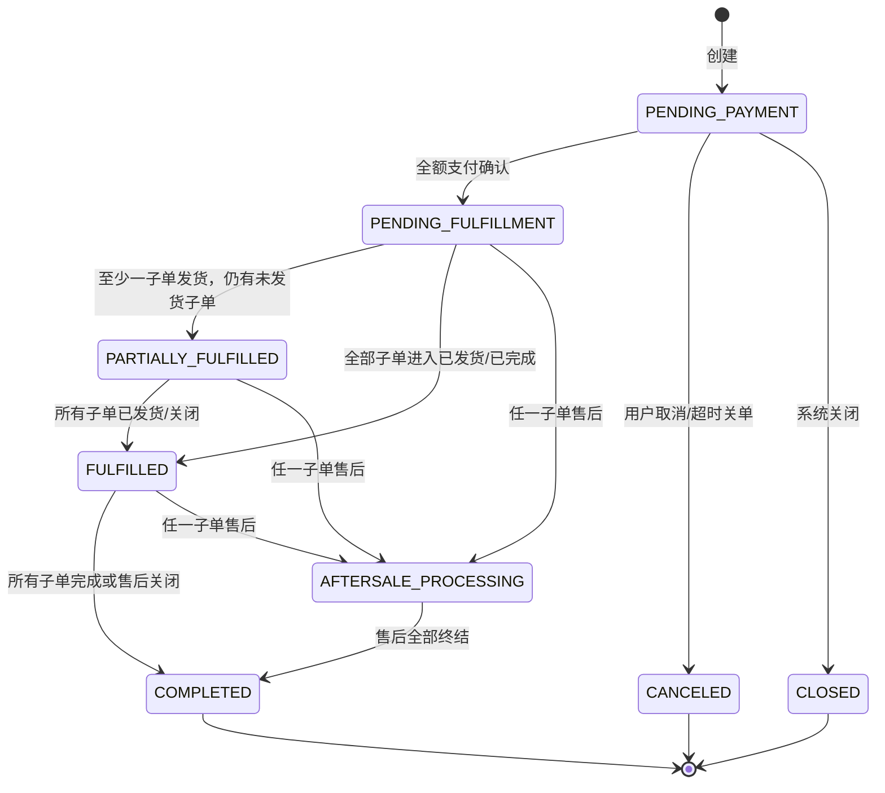
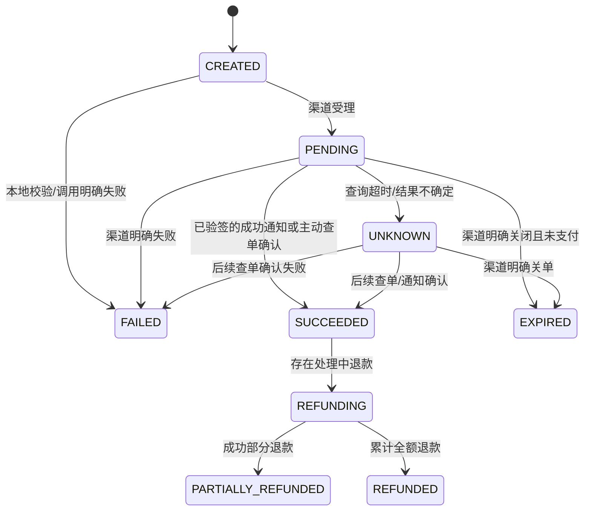
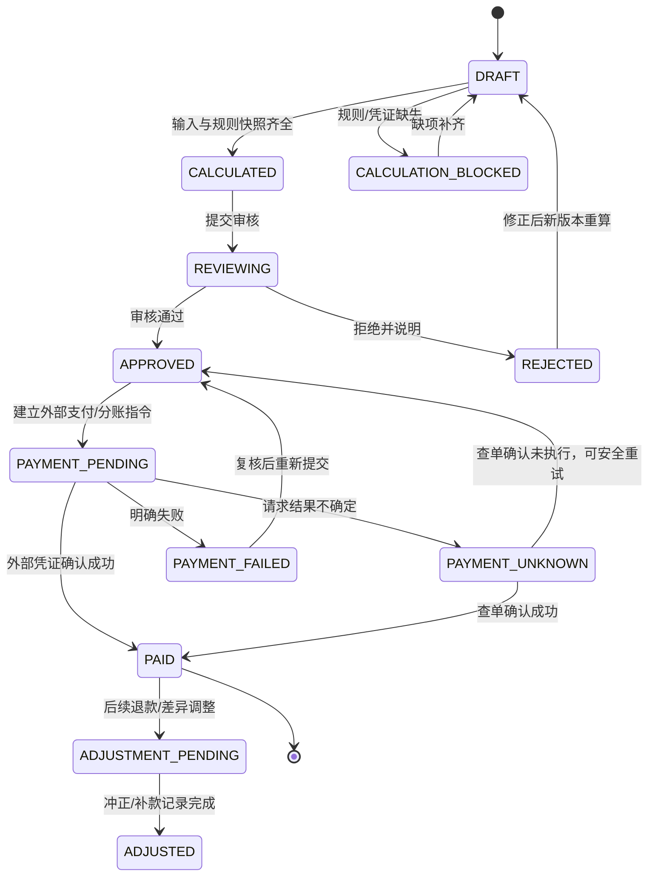

# 电商平台 Phase 1 — 架构补强与最终验收报告

版本：1.0（设计补强稿）  
状态：Phase 1 设计输出；等待用户确认；**未启动 Phase 2，未执行实现或测试**  
依据：用户提供的《电商平台思维导图》图片，以及明确提出的平台自营+第三方入驻、多商家购物车拆单、真实支付/结算和合规约束。原图模糊内容仍标待确认。

## 1. 已修复问题

1. 定义主订单、商家子订单、支付尝试、退款、售后状态机及转换前置条件，覆盖超时、重复回调、部分退款、重复退款和异常补偿。
2. 定义渠道无关的商家结算对象、不可变账务分录、结算批次状态机、对账差异处理、幂等键；未假定渠道支持原生分账。
3. 定义可售/锁定库存、预占、支付确认扣减、超时释放、取消和退款库存策略，以及数据库并发防超卖方案。
4. 定义商家租户数据隔离的后端强制规则及 A/B 越权验收矩阵，覆盖商品、订单、库存、售后、结算、员工。
5. 新建逐项追踪矩阵：每个原图 REQ 编号均指向页面、API、数据表和验收用例。专项约束单独编号，不冒充原图节点。

## 2. 订单与支付状态机

### 2.1 对象与边界

- **订单（主订单）**：消费者一次结算形成的聚合，关联一个或多个商家子订单。主订单只汇总状态，不代替商家履约状态。
- **商家子订单**：按商家拆分的履约与售后边界；商家只能访问所属子单。
- **支付单/支付尝试**：一次渠道支付意图。重试产生新的 attempt；对一个主订单成功的有效支付金额不得超过应付金额。渠道订单号唯一。
- **退款单**：每次退款请求独立记录；允许一个子订单有多笔成功部分退款，但累计成功退款不得超过该子单可退金额。
- **售后单**：退款/退货退款申请和审核履约流程；售后申请本身不等于退款成功。

所有金额按最小货币单位整数存储或 DECIMAL(18,2) 精确运算，禁止浮点。状态变更与相应流水在同一数据库事务中落库；外部渠道调用采用 outbox/worker 异步衔接，不能跨数据库和渠道假造原子事务。

### 2.2 主订单状态

建议数据库存储一个业务主状态及独立履约/售后汇总状态，避免将并行子单压成错误的单一线性状态。`CLOSED` 仅表示未支付订单关闭；已支付订单的退款不会把订单改成“未支付关闭”，而保留支付事实并记录退款/售后状态。

| 操作 | 前置条件 | 原子状态/数据变化 | 拒绝/补偿 |
|---|---|---|---|
| 创建订单 | 用户有效；SKU有效且可售；地址/价格快照有效；库存成功预占；幂等键未处理 | 主单 `PENDING_PAYMENT`；按商家创建子单；订单行快照；预占库存；创建支付意图 | 任一检查失败整体回滚/释放已预占；同幂等键返回原订单 |
| 支付成功 | 订单仍待付款或处于可接受支付确认窗口；渠道签名、金额、币种、商户订单号均匹配 | 支付尝试 `SUCCEEDED`；支付账本唯一入账；主单进入已支付汇总；子单进入待履约；预占转实扣 | 回调晚到且订单已关：不能静默复活；按渠道能力执行自动退款/人工异常队列，保持审计 |
| 用户取消 | 主单待付款且无成功支付；子单均未履约 | 主/子单取消；释放未过期预占 | 若支付竞争中：锁行后检查；已经支付则拒绝取消，转退款流程 |
| 支付超时 | 支付等待超过配置期限；支付渠道查询/关单策略满足要求 | 主/子单关闭/取消；预占释放；支付尝试标记 `EXPIRED` 或 `CLOSE_PENDING` | 不能只按本地时钟释放：先查询/关单渠道；渠道未知状态进入待核实并继续保留库存至安全期限 |
| 商家发货 | 商家身份有效且属于子单 merchant_id；子单待发货；支付已确认；有效物流信息（自提规则待确认） | 子单 `SHIPPED`，写物流事件；主单重算部分/全部发货汇总 | 重复同一运单请求幂等返回；不同运单重复发货拒绝并审计 |
| 确认收货 | 子单已发货；用户是订单所有者，或自动确认期限/规则已明确 | 子单 `COMPLETED`；更新主单汇总 | 重复确认幂等；自动确认时限待业务确认 |
| 申请售后 | 支付成功；订单行仍在可申请窗口；可退数量/金额正数且未超余额；满足售后类型前置条件 | 创建售后 `REQUESTED`；锁定可退额，防并发超退 | 重复幂等键返回原申请；超可退额度拒绝 |
| 退款完成 | 售后已批准（或明确免审核策略）；退款金额不超剩余可退额；退款请求渠道状态允许 | 退款单成功；支付退款流水；释放/调整结算应收与佣金/积分的冲正事件 | 同一退款幂等键唯一；渠道超时先查单，不重复发起不确定的退款 |

主订单状态是由其子订单和支付事实派生；不能以覆盖主状态的方式抹掉晚到支付、部分发货或部分退款事实。主单订单详情必须同时展示各子单状态。

### 2.3 子订单状态

`PENDING_PAYMENT → PENDING_FULFILLMENT → SHIPPED → COMPLETED`；在付款前可 `CANCELED`。付款后取消/退货以售后与退款记录表达，不删除订单，也不回退为待付款。允许售后与履约并行，以独立 `fulfillment_status` 和 `aftersale_status` 表达；部分商品退款时订单行记录 `refunded_qty/refunded_amount`。

- 建单：子单商品只能属于同一商家，快照含商家、SKU、单价、促销/积分分摊；平台自营也使用 merchant_id 指向平台商家主体。
- 发货：仅子单所属商家员工或具权限平台操作员；支付已确认；待发货；运单写入不可变物流事件。
- 关单：仅未支付；不得因为一个子单超时而错误取消已经支付的其他商家子单。多商家主单的支付/超时粒度与支付服务能力需定稿，默认主单一次收款、所有子单同一付款结果。
- 完成：用户确认收货或经确认的自动确认规则；所有子单分别完成后重算主单。

### 2.4 支付单状态

渠道通知只作为待验事件：先验签、比对 provider、merchant_order_no、金额、币种、渠道 transaction id；对渠道事件 ID 建唯一约束。重复成功通知回同一成功结果，不重复加账、扣库存、发佣金。成功通知和支付超时并发时，订单行/支付尝试行使用事务锁与版本号串行化。未确定失败不得释放库存或创建第二笔可同时成功的付款；如渠道支持关单/撤销，则先确认终态；否则进入 `UNKNOWN` 并由查单补偿任务处理。

### 2.5 退款单状态与部分退款

`REQUESTED → APPROVED → SUBMITTING → SUCCEEDED`；可在审核/提交前拒绝为 `REJECTED`；明确失败为 `FAILED`；结果不确定为 `UNKNOWN`，经渠道查询转成功/失败。失败重试必须沿用原业务退款请求标识并遵守渠道幂等策略；不得为同一笔未知结果创建第二个可实际退款请求。

- 额度公式：`remaining_refundable = captured_amount - sum(successful_refund_amount) - sum(active_reserved_refund_amount)`。并发创建退款时，在支付/子单账务行上锁定并原子预留额度。
- 部分退款允许多笔，但所有成功退款合计不超过可退金额；按商品、运费、优惠、积分、平台服务费、佣金的反向分摊公式需业务确认。未经确认不自动退积分或扣佣金。
- 重复退款请求用业务幂等键（如售后单+退款阶段）唯一约束；通知事件 ID 和渠道退款号也唯一。重复请求返回既有退款，不重复调用渠道。
- 渠道调用前落 `SUBMITTING` 与 outbox；worker 调用后记录请求/响应摘要（敏感信息脱敏）。崩溃恢复先按渠道退款号/商户退款号查询，再决定是否重试。
- 退款成功后产生退款流水、结算冲正、服务费/支付手续费调整、推广佣金冲正候选、积分冲正候选；每类按明确规则单独入账。不能直接改写原支付/佣金账本。

### 2.6 售后单状态

`REQUESTED → UNDER_REVIEW → APPROVED → (RETURN_PENDING → RETURN_SHIPPED → RETURN_RECEIVED) → REFUND_PENDING → REFUNDED → CLOSED`。仅退款可由 `APPROVED → REFUND_PENDING`；`REJECTED`、用户撤销（退款提交前）、超时关闭为终态/关闭原因。原图仅识别“退款/售后”，退货环节、窗口、举证和自动同意期限均为待确认，状态机是承载能力设计，不代表已批准业务政策。

售后单和退款单分离。一个订单行允许多次部分售后，但按数量和金额预留额度。商家只能审核自己的子单；平台仲裁角色可按确认的权限查看与处理。售后状态改变必须记录操作者、理由、时间和关联物流/退款事件。

### 2.7 异常补偿与对账任务

- 支付回调：签名验真、原始事件去重存档、异步处理；周期查 `PENDING/UNKNOWN`；回调失败可重放；重复处理无副作用。
- 支付成功但本地提交失败：渠道查单补偿，重放成功事件；若订单已超时且不应复活，则进入退款异常队列，不能丢弃支付事实。
- 本地已超时但渠道仍 `PENDING`：执行渠道关单/查单；确认未支付后释放预占；状态未知时保留安全库存锁并告警。
- 库存释放/扣减失败：事务 outbox 重试，库存流水唯一业务来源键；差异进入人工处理队列，不重复扣减。
- 退款调用超时：标 `UNKNOWN`，主动查退款结果后补记；不盲目重复退款。
- 每个补偿任务记录尝试次数、最后错误、下次重试时间、告警和人工结案记录；禁止无上限高速重试。

## 3. 多商家结算与渠道无关账务

### 3.1 设计原则与金额对象

结算分账不是“更新商家余额”。采用不可变、借贷平衡的内部应收/应付子账和外部渠道资金事实：真实分账/付款由经确认具备资质与能力的服务商执行。应用不能声称渠道支持原生分账；渠道不支持时，结算批次只可形成待付款指令，须按可用的合规支付方式人工/批量执行，并回写外部凭证。

每个订单/子单需要有金额快照：

- `gross_goods_amount`：商品成交金额（未定义税务口径，待确认）。
- `customer_paid_amount`：渠道实际收款金额，不含纯积分抵扣部分；积分资金/抵扣需独立负债账本，不能伪装现金。
- `merchant_gross_receivable`：商家按合同应得的商品金额基础。
- `platform_service_fee`：按商家合同/订单规则计的平台服务费，费率/基数尚待确认。
- `payment_channel_fee`：支付渠道实际收取费用；只有渠道账单证据确认后入账。谁承担、分摊到商家或平台待确认。
- `promotion_commission`：已归属的推广应付金额，受规则版本与合规开关约束；禁止启用未审核多层计酬。
- `merchant_net_payable`：某结算范围内商家应收减商家承担费用/退款/调整的净应付，必须按确认合同口径计算。平台服务费和佣金承担方尚未确认前，系统只保存独立分量，不预设公式。
- `merchant_pending_settlement` 与 `merchant_settled`：分别为已确认可结算但未成功付款的净额、渠道/银行实际付款成功的累计净额。它们是从账本投影重算的显示值，不是资金事实本身。
- 退款及调整使用有原分录引用的冲正/调整分录；禁止修改旧金额。

金额算式是配置化且版本化的纯函数，只有确认商家合同、费率、促销和积分规则后才能启用。建单时保存规则版本/输入快照，复算必须可审计。

### 3.2 账务与结算表（新增/修订）

| 表 | 关键字段与约束 |
|---|---|
| payment_orders | id, order_id, provider_code(nullable), provider_order_no, amount_minor, currency, status, idempotency_key UNIQUE, version；一主单支付策略待确认 |
| payment_events | provider_code, provider_event_id UNIQUE, event_type, received_at, signature_valid, payload_hash, processing_status；原始敏感报文加密/脱敏 |
| payment_transactions | payment_order_id, provider_txn_id UNIQUE, amount_minor, status, confirmed_at |
| refund_orders | id, sub_order_id, aftersale_id, amount_minor, merchant_refund_no UNIQUE, provider_refund_no UNIQUE nullable, status, idempotency_key UNIQUE |
| refund_events | provider_code, event_id UNIQUE, refund_order_id, result, payload_hash |
| settlement_rule_versions | id, merchant_id nullable, version, effective_at, rule_json, approved_by；未批准不可生效 |
| settlement_calculations | id, sub_order_id, rule_version_id, input_snapshot_json, gross, service_fee, channel_fee, commission, merchant_net, calculated_at |
| finance_accounts | id, owner_type(platform/merchant/user/provider), owner_id, account_code, currency；无可直接提现的虚构“现金余额”字段 |
| finance_journals | id, source_type, source_id, idempotency_key UNIQUE, status, created_at |
| finance_entries | journal_id, account_id, debit_minor, credit_minor, currency, reversal_of_entry_id；借贷平衡、原记录不可更新 |
| settlement_batches | id, merchant_id, period_start/end, currency, amount_minor, status, idempotency_key UNIQUE, provider_batch_ref, version |
| settlement_lines | batch_id, sub_order_id, calculation_id, amount_minor, source_entry_id UNIQUE；一订单应收只能按可追踪调整拆分 |
| settlement_adjustments | id, merchant_id, source_type, source_id, amount_minor(+/-), reason, approval_id, reversal_of_id, idempotency_key UNIQUE |
| channel_statements | provider_code, statement_date, file_hash, imported_at, currency |
| channel_statement_lines | statement_id, external_ref, type, amount_minor, fee_minor, occurred_at, matched_internal_id, match_status, exception_code；外部行键需唯一 |
| reconciliation_runs | provider_code, period, status, started_at, completed_at, difference_count, run_key UNIQUE |
| reconciliation_exceptions | run_id, external_line_id, internal_ref, category, amount_diff, status, resolution_note, resolved_by |
| outbox_events | aggregate_type/id, event_type, idempotency_key UNIQUE, payload, status, attempts, next_attempt_at |

记账分录按事件类型定义借贷模板并经过会计评审；本文不预断平台会计科目映射或税务口径。对任何已确认支付/退款/渠道手续费/商家付款，需保存外部凭证号与原始内部事件关联。

### 3.3 结算明细及状态机

**结算计算**按子订单/账期生成 immutable calculation，显示商家应收、平台费、渠道手续费、佣金、退款和调整各列；规则缺失时标 `CALCULATION_BLOCKED`，不得默认为零费率后放款。

批次中一部分付款成功时必须逐商家/逐行拆分状态，不能整批误标 `PAID`。每条结算行关联来源子账；退款发生在付款前，重算未付应收；退款发生在已付款后，生成未来结算扣回或独立应收调整，不能把已付批次改成未付。

### 3.4 对账、幂等与异常处理

- 适配器接口只定义能力，不预设渠道：`create_payment`、`query_payment`、`close_payment`（可选能力）、`create_refund`、`query_refund`、`submit_payout_or_split`（可选）、`query_payout_or_split`、`verify_webhook`、`fetch_statement`（可选）。每项能力由 adapter capability 声明；不支持时 API 返回明确 `CAPABILITY_UNAVAILABLE`，改用经批准的替代结算流程。
- 内部 merchant order/refund/batch ID 与幂等键由平台生成，渠道号映射单独存储。唯一键建议 `(provider_code, provider_event_id)`、`(provider_code, provider_txn_id)`、`merchant_refund_no`、`settlement_batch.idempotency_key`。
- 对账按支付、退款、手续费、分账/商家付款各自独立匹配：金额、币种、状态、时间窗和渠道参考号。匹配项不得重复导入；文件 hash+行键防重复。
- 差异分类：渠道有/内部无、内部有/渠道无、金额差异、手续费差异、状态不一致、重复外部行、币种差异。差异冻结相关未结算额并生成异常单；处置需理由、证据、双人复核策略待财务确认。
- 渠道事件重复：唯一事件记录命中即返回成功接收，不重复记账。内部请求超时：状态标 UNKNOWN，先查询渠道，禁止盲目再次付款/退款。渠道回调与主动查单冲突时，以已验真的终态证据按事件版本/渠道规则归并，保留全部证据。
- 结算批次创建、审核、提交、回写均有业务幂等键。批次重复提交返回既有状态；不同净额不得复用同幂等键。
- 资金异常可挂起商家结算、标记异常原因、指定处理人/到期告警；人工调整必须双重授权（是否双人由项目方确认）并只追加调整/冲正流水。

## 4. 库存并发与防超卖

### 4.1 定义及表

- `on_hand`：仓内可盘实库存（不含已实际出库的数量）。
- `reserved`：有效订单预占的锁定量。
- `available`（可售库存）：`on_hand - reserved - safety_stock`，下限为 0。
- `reservation`：每个订单行/SKU 的预占记录，状态 `ACTIVE/COMMITTED/RELEASED/EXPIRED`，含 quantity、expires_at、version、idempotency_key。
- `inventory_movement`：不可变的预占、扣减、释放、退货入库、盘点调整流水；余额为投影，可从流水重建。

建议 `inventory_balances(sku_id PK, on_hand, reserved, safety_stock, version)`、`inventory_reservations(id, order_item_id, sku_id, quantity, status, expires_at, idempotency_key UNIQUE)`、`inventory_movements(id, sku_id, quantity_delta_on_hand, quantity_delta_reserved, event_type, source_type, source_id, idempotency_key UNIQUE)`。数据库约束检查数量非负。

### 4.2 操作策略

1. **创建订单预占**：对 SKU 按 id 排序后事务内 `SELECT ... FOR UPDATE` 锁余额行；校验 `on_hand-reserved-safety_stock >= request_qty`；原子增加 reserved 并写 reservation/movement；任一 SKU 失败整笔回滚。也可用条件原子更新 `UPDATE ... SET reserved=reserved+:q, version=version+1 WHERE id=:id AND on_hand-reserved-safety_stock>=:q`，必须检查受影响行数为 1。
2. **支付成功**：事务锁定 reservation；仅 `ACTIVE` 可转 `COMMITTED`。支付成功时实物库存从在手转出（on_hand 减 q，reserved 减 q），写唯一扣减流水；对重复支付通知用支付事件/库存来源唯一键避免重复扣减。
3. **超时释放**：不能只由本地计时器释放。先确认支付渠道未成功且已关单/过安全终态；再锁 reservation，`ACTIVE→EXPIRED` 并减少 reserved，写 release 流水。UNKNOWN 支付保持预占并告警，按业务确认的最大保留时间进入人工处理，不允许冒险超卖。
4. **用户取消**：仅未支付单且预占 ACTIVE 时 `RELEASED`；取消与支付回调通过同一订单/预占锁串行化。若支付已成功，改走退款/售后，库存不可简单回补。
5. **退款**：仅退款（未出库）是否回补可售库存由商品和退款原因策略决定；发货后退货须等仓库确认可再销售，再增加 on_hand 并记 `RETURN_RESTOCKED`；损坏品不回补。原图无该规则，需业务确认。
6. **防超卖**：事务行锁/条件更新、SKU 多行按固定顺序锁、防死锁重试、数据库唯一流水键、事务 outbox、有限事务时长。缓存库存只可读展示，不作为最终扣减判定。高并发订单先成功预占者获得库存，失败者明确缺货。
7. **超时与清理**：定时 worker 扫描 `expires_at` 到期记录并逐条幂等处理；不能批量无锁改余额。订单与 reservation 状态对账，发现不匹配冻结该 SKU 的异常预占并告警。

## 5. 商家权限隔离设计与验收矩阵

所有隔离均由 FastAPI 后端在每个请求执行，前端隐藏菜单不算安全控制。JWT/session 的 actor 只映射经认证的 `merchant_id` 和授权角色；客户端提交的 merchant_id 不能作为授权依据。查询按授权上下文注入 `WHERE merchant_id = :authorized_merchant_id`；写入时同时校验资源归属和状态转换。平台管理员访问需显式权限并审计。缓存 key、导出任务、异步消息、文件下载签名也必须带租户边界。

| 测试ID | A 身份尝试访问 B 资源 | 期望后端行为 | 覆盖接口/对象 |
|---|---|---|---|
| SEC-TEN-001 | GET/修改/上下架 B 商品（猜测 ID） | 404（避免泄漏存在性）或统一拒绝；无数据变更 | 商品详情、更新、上下架、媒体 |
| SEC-TEN-002 | 查看/修改 B 子订单及买家信息 | 拒绝；不得返回订单行/收货信息 | 商家订单列表/详情/导出 |
| SEC-TEN-003 | 对 B SKU 改价、盘点、预占/释放库存 | 拒绝且不写库存流水 | 库存接口及后台任务 |
| SEC-TEN-004 | 查看/审核/发货/退款 B 售后 | 拒绝；退款不得向渠道发起 | 售后审核、发货、退款 |
| SEC-TEN-005 | 查看/下载/改状态 B 结算批次与明细 | 拒绝；对象存储链接不可越租户访问 | 结算、对账、凭证下载 |
| SEC-TEN-006 | 查询/禁用/改角色 B 商家员工 | 拒绝；不得变更员工权限 | 员工列表、详情、邀请、禁用、角色 |
| SEC-TEN-007 | 将 URL merchant_id、body merchant_id、header merchant_id 改为 B | 服务端忽略或校验失败；只按授权上下文 | 全部商家 API |
| SEC-TEN-008 | 利用批量 ID、分页、搜索、统计、CSV 导出请求 B 资源 | 结果完全限定 A；不得由过滤参数绕过 | 列表、报表、导出 |
| SEC-TEN-009 | 重放/篡改异步任务 ID、下载令牌、缓存键 | worker 与签名下载再次校验 tenant scope | worker、COS presign、缓存 |
| SEC-TEN-010 | 未登录、普通用户、无权限商家员工调用管理 API | 401/403；无写入；审计高风险拒绝 | 所有管理端点 |

验收采用两个商家 A/B、各自员工与商品/订单/库存/售后/结算种子数据逐项执行，并核对数据库无副作用、审计记录完整。所有 API 单元/集成验收必须覆盖对象所有权检查；仅前端测试不通过验收。

## 6. 需求追踪矩阵

说明：每个编号逐条出现；页面/API/表为归属映射，`TC-REQ-*` 为必须建立的独立验收用例编号。`TBC` 用例只验收“保留未确认且不启用”，不能验收猜测出的规则。原图附件为缩放图，节点总数仍须源文件复核。

| 需求编号 | 页面 | API | 数据表 | 验收用例 |
|---|---|---|---|---|
| REQ-FE-HOME-001 | 商城首页搜索栏 | GET /products?q= | products,categories | TC-REQ-FE-HOME-001 搜索结果/空结果 |
| REQ-FE-HOME-002 | 商城首页 Banner | GET /banners | banners,product_media | TC-REQ-FE-HOME-002 上下线与展示 |
| REQ-FE-HOME-003 | 商城首页消息 | GET /notices | notices | TC-REQ-FE-HOME-003 已读/未读与空状态 |
| REQ-FE-HOME-004 | 首页自选推荐 | GET /storefront/home | products,skus | TC-REQ-FE-HOME-004 推荐内容；抵扣规则 TBC |
| REQ-FE-HOME-005 | 首页复购推荐 | GET /storefront/home | products,skus,point_ledger | TC-REQ-FE-HOME-005 规则确认前不结算积分比例 |
| REQ-FE-HOME-006 | 底部导航：首页、自选区、复购区、我的 | 前端路由；各页 GET API | 无/相关域表 | TC-REQ-FE-HOME-006 四入口到达正确页面；购物车保留独立入口 |
| REQ-FE-PICK-001 | 自选区筛选/排序 | GET /products?type=pick&sort= | products,skus | TC-REQ-FE-PICK-001 全部/销量/价格 |
| REQ-FE-PICK-002 | 自选区分类 | GET /categories?type=pick | categories | TC-REQ-FE-PICK-002 确认分类原文后逐项显示 |
| REQ-FE-PICK-003 | 自选商品列表图片 | GET /products | products,product_media | TC-REQ-FE-PICK-003 图片及缺图 |
| REQ-FE-PICK-004 | 自选商品列表名称 | GET /products | products | TC-REQ-FE-PICK-004 名称映射 |
| REQ-FE-PICK-005 | 自选商品列表销量 | GET /products | products/order_items | TC-REQ-FE-PICK-005 统计口径待确认 |
| REQ-FE-PICK-006 | 自选商品列表价格 | GET /products | skus | TC-REQ-FE-PICK-006 SKU 价格 |
| REQ-FE-PICK-007 | 自选列表加购 | POST /cart/items | carts,cart_items,skus | TC-REQ-FE-PICK-007 库存/重复点击 |
| REQ-FE-PICK-008 | 自选商品详情媒体 | GET /products/{id} | products,product_media | TC-REQ-FE-PICK-008 图/视频播放 |
| REQ-FE-PICK-009 | 自选详情名称 | GET /products/{id} | products | TC-REQ-FE-PICK-009 名称一致 |
| REQ-FE-PICK-010 | 自选详情价格 | GET /products/{id} | skus | TC-REQ-FE-PICK-010 SKU 价格一致 |
| REQ-FE-PICK-011 | 自选详情销量 | GET /products/{id} | products/order_items | TC-REQ-FE-PICK-011 口径待确认 |
| REQ-FE-PICK-012 | 自选详情分享 | GET /products/{id}/share | products | TC-REQ-FE-PICK-012 分享链接可达 |
| REQ-FE-PICK-013 | 自选详情描述 | GET /products/{id} | products | TC-REQ-FE-PICK-013 描述安全渲染 |
| REQ-FE-PICK-014 | 自选详情回首页 | 前端路由 | 无 | TC-REQ-FE-PICK-014 返回首页 |
| REQ-FE-PICK-015 | 自选详情在线咨询 | GET/POST /consultations | consultations | TC-REQ-FE-PICK-015 建立咨询会话 |
| REQ-FE-PICK-016 | 自选详情收藏 | POST/DELETE /favorites | favorites | TC-REQ-FE-PICK-016 收藏/取消幂等 |
| REQ-FE-PICK-017 | 自选详情加购 | POST /cart/items | carts,cart_items | TC-REQ-FE-PICK-017 SKU/数量加购 |
| REQ-FE-PICK-018 | 自选详情立即购买 | POST /checkout/preview,/orders | orders,sub_orders,order_items,inventory_reservations | TC-REQ-FE-PICK-018 建单与预占 |
| REQ-FE-REBUY-001 | 复购区商品列表/详情 | GET /products?type=rebuy | products,product_media,skus | TC-REQ-FE-REBUY-001 映射全部同上展示节点 |
| REQ-FE-REBUY-002 | 复购下单确认 | POST /checkout/preview,/orders | point_ledger,orders,order_items | TC-REQ-FE-REBUY-002 30/70 规则 TBC 且未确认不启用 |
| REQ-FE-CART-001 | 购物车 | GET /cart | carts,cart_items | TC-REQ-FE-CART-001 仅本人商品 |
| REQ-FE-CART-002 | 购物车商家分组 | GET /cart | merchants,cart_items | TC-REQ-FE-CART-002 正确分组 |
| REQ-FE-CART-003 | 购物车图片 | GET /cart | product_media | TC-REQ-FE-CART-003 图片映射 |
| REQ-FE-CART-004 | 购物车标题 | GET /cart | products | TC-REQ-FE-CART-004 标题映射 |
| REQ-FE-CART-005 | 购物车价格 | GET /cart | skus | TC-REQ-FE-CART-005 价格实时校验 |
| REQ-FE-CART-006 | 购物车数量 | PATCH /cart/items/{id} | cart_items,inventory_balances | TC-REQ-FE-CART-006 数量边界/库存不足 |
| REQ-FE-CART-007 | 购物车删除 | DELETE /cart/items/{id} | cart_items | TC-REQ-FE-CART-007 仅本人可删 |
| REQ-FE-CART-008 | 购物车全选 | PATCH /cart/selection | cart_items | TC-REQ-FE-CART-008 全选/取消全选 |
| REQ-FE-CART-009 | 购物车结算 | POST /checkout/preview,/orders | orders,sub_orders,order_items | TC-REQ-FE-CART-009 跨商家拆单 |
| REQ-FE-DIST-001 | 分销中心等级说明 | GET /distribution/profile | member_tiers,member_tier_history | TC-REQ-FE-DIST-001 3999 规则待合规确认 |
| REQ-FE-DIST-002 | 分销中心等级说明 | GET /distribution/profile | member_tiers,member_tier_history | TC-REQ-FE-DIST-002 10000 规则待合规确认 |
| REQ-FE-DIST-003 | 推广收益说明 | GET /distribution/rules | commission_rules | TC-REQ-FE-DIST-003 10% 基数 TBC/功能关闭 |
| REQ-FE-DIST-004 | 推广等级权益 | GET /distribution/rules | commission_rules | TC-REQ-FE-DIST-004 原词不清，不实施 |
| REQ-FE-DIST-005 | 会员积分明细 | GET /points/product/ledger | point_ledger | TC-REQ-FE-DIST-005 3999 积分规则待确认 |
| REQ-FE-DIST-006 | 会员复购积分明细 | GET /points/rebuy/ledger | point_ledger | TC-REQ-FE-DIST-006 3999 规则待确认 |
| REQ-FE-DIST-007 | 分红收益明细 | GET /commissions | commission_ledger | TC-REQ-FE-DIST-007 封顶/增量待确认且关闭 |
| REQ-FE-DIST-008 | 推广收益说明 | GET /distribution/rules | commission_rules | TC-REQ-FE-DIST-008 10% 基数 TBC/功能关闭 |
| REQ-FE-DIST-009 | 推广等级权益 | GET /distribution/rules | commission_rules | TC-REQ-FE-DIST-009 原词不清，不实施 |
| REQ-FE-DIST-010 | 会员积分明细 | GET /points/product/ledger | point_ledger | TC-REQ-FE-DIST-010 10000 积分规则待确认 |
| REQ-FE-DIST-011 | 会员复购积分明细 | GET /points/rebuy/ledger | point_ledger | TC-REQ-FE-DIST-011 10000 规则待确认 |
| REQ-FE-DIST-012 | 分红收益明细 | GET /commissions | commission_ledger | TC-REQ-FE-DIST-012 规则待确认且关闭 |
| REQ-FE-DIST-013 | 推广收益明细 | GET /commissions | commission_ledger | TC-REQ-FE-DIST-013 200 元适用规则 TBC |
| REQ-FE-DIST-014 | 邀请码/二维码 | GET /invitations | users,referrals | TC-REQ-FE-DIST-014 唯一归属/不可伪造 |
| REQ-FE-DIST-015 | 我的推荐 | GET /referrals | referrals,users | TC-REQ-FE-DIST-015 仅本人邀请链可见 |
| REQ-FE-DIST-016 | 我的收益可提现 | GET /wallet/summary | commission_ledger,withdrawals | TC-REQ-FE-DIST-016 合规/渠道未确认禁用提现 |
| REQ-FE-DIST-017 | 收益明细 | GET /commissions | commission_ledger | TC-REQ-FE-DIST-017 流水可追溯 |
| REQ-FE-ME-001 | 我的资料头像 | GET/PATCH /users/me | users | TC-REQ-FE-ME-001 上传与展示 |
| REQ-FE-ME-002 | 我的资料昵称 | GET/PATCH /users/me | users | TC-REQ-FE-ME-002 校验长度 |
| REQ-FE-ME-003 | 我的资料 ID | GET /users/me | users | TC-REQ-FE-ME-003 ID只读唯一 |
| REQ-FE-ME-004 | 我的角色信息 | GET /users/me | member_tiers,member_tier_history | TC-REQ-FE-ME-004 显示已确认等级 |
| REQ-FE-ME-005 | 钱包余额 | GET /wallet/summary | finance_entries,commission_ledger | TC-REQ-FE-ME-005 只展示可提现已确认金额 |
| REQ-FE-ME-006 | 提现 | POST /withdrawals | withdrawals,commission_ledger | TC-REQ-FE-ME-006 未确认资格/通道禁用 |
| REQ-FE-ME-007 | 推广收益明细 | GET /commissions | commission_ledger | TC-REQ-FE-ME-007 仅本人记录 |
| REQ-FE-ME-008 | 产品积分余额 | GET /points/product/balance | point_accounts,point_ledger | TC-REQ-FE-ME-008 余额与流水可重算 |
| REQ-FE-ME-009 | 产品积分明细 | GET /points/product/ledger | point_ledger | TC-REQ-FE-ME-009 分页及方向 |
| REQ-FE-ME-010 | 复购积分余额 | GET /points/rebuy/balance | point_accounts,point_ledger | TC-REQ-FE-ME-010 余额与流水可重算 |
| REQ-FE-ME-011 | 复购积分明细 | GET /points/rebuy/ledger | point_ledger | TC-REQ-FE-ME-011 分页及方向 |
| REQ-FE-ME-012 | 我的订单 | GET /orders | orders,sub_orders | TC-REQ-FE-ME-012 状态映射待确认 |
| REQ-FE-ME-013 | 在线咨询 | GET/POST /consultations | consultations | TC-REQ-FE-ME-013 会话归属校验 |
| REQ-FE-ME-014 | 我的收藏 | GET/DELETE /favorites | favorites | TC-REQ-FE-ME-014 仅本人数据 |
| REQ-FE-ME-015 | 我的足迹 | GET/DELETE /browse-history | browse_history | TC-REQ-FE-ME-015 仅本人数据 |
| REQ-FE-ME-016 | 收货地址 | CRUD /addresses | user_addresses | TC-REQ-FE-ME-016 默认地址唯一/本人隔离 |
| REQ-ADM-GOODS-001 | 后台商品分类 | POST /admin/categories | categories | TC-REQ-ADM-GOODS-001 创建及权限 |
| REQ-ADM-GOODS-002 | 后台商品分类 | DELETE /admin/categories/{id} | categories,products | TC-REQ-ADM-GOODS-002 有商品分类删除约束 |
| REQ-ADM-GOODS-003 | 后台商品分类 | PATCH /admin/categories/{id} | categories | TC-REQ-ADM-GOODS-003 修改/审计 |
| REQ-ADM-GOODS-004 | 后台分类管理 | GET /admin/categories | categories | TC-REQ-ADM-GOODS-004 层级排序 |
| REQ-ADM-GOODS-005 | 后台商品列表 | GET /admin/products | products,skus | TC-REQ-ADM-GOODS-005 权限/分页 |
| REQ-ADM-GOODS-006 | 后台商品详情 | GET /admin/products/{id} | products,skus,product_media | TC-REQ-ADM-GOODS-006 快照完整 |
| REQ-ADM-GOODS-007 | 后台商品编辑 | POST /admin/products | products,skus,product_media | TC-REQ-ADM-GOODS-007 字段校验 |
| REQ-ADM-GOODS-008 | 后台商品编辑 | PATCH /admin/products/{id} | products,skus | TC-REQ-ADM-GOODS-008 版本/审计 |
| REQ-ADM-GOODS-009 | 后台商品编辑 | PATCH /admin/products/{id} | products,skus,product_media | TC-REQ-ADM-GOODS-009 编辑权限 |
| REQ-ADM-GOODS-010 | 后台上下架 | POST /admin/products/{id}/publish | products | TC-REQ-ADM-GOODS-010 上架条件/审计 |
| REQ-ADM-ORDER-001 | 后台订单筛选 | GET /admin/orders?status= | orders,sub_orders | TC-REQ-ADM-ORDER-001 状态定义待确认 |
| REQ-ADM-ORDER-002 | 后台订单汇总 | GET /admin/orders/summary | orders,order_items | TC-REQ-ADM-ORDER-002 统计口径待确认 |
| REQ-ADM-ORDER-003 | 后台订单详情商品 | GET /admin/orders/{id} | order_items,products | TC-REQ-ADM-ORDER-003 商品快照 |
| REQ-ADM-ORDER-004 | 后台订单详情买家 | GET /admin/orders/{id} | orders,users | TC-REQ-ADM-ORDER-004 PII权限与审计 |
| REQ-ADM-MEMBER-001 | 后台会员列表 | GET /admin/members | users | TC-REQ-ADM-MEMBER-001 分页/权限 |
| REQ-ADM-MEMBER-002 | 后台会员管理 | PATCH /admin/members/{id} | users | TC-REQ-ADM-MEMBER-002 修改审计 |
| REQ-ADM-MEMBER-003 | 后台会员筛选普通会员 | GET /admin/members?tier= | users,member_tier_history | TC-REQ-ADM-MEMBER-003 等级映射 |
| REQ-ADM-MEMBER-004 | 后台会员筛选合伙人 | GET /admin/members?tier= | users,member_tier_history | TC-REQ-ADM-MEMBER-004 规则确认前不赋级 |
| REQ-ADM-MEMBER-005 | 后台会员筛选联创 | GET /admin/members?tier= | users,member_tier_history | TC-REQ-ADM-MEMBER-005 规则确认前不赋级 |
| REQ-ADM-MEMBER-006 | 后台会员详情 | GET /admin/members/{id} | users,member_tier_history | TC-REQ-ADM-MEMBER-006 权限/敏感字段 |
| REQ-ADM-MEMBER-007 | 后台会员地址 | GET /admin/members/{id}/addresses | user_addresses | TC-REQ-ADM-MEMBER-007 访问审计 |
| REQ-ADM-MEMBER-008 | 后台消费统计 | GET /admin/members/{id}/statistics | orders,sub_orders | TC-REQ-ADM-MEMBER-008 口径待确认 |
| REQ-ADM-MEMBER-009 | 后台自选订单 | GET /admin/members/{id}/orders?type=pick | orders,order_items,products | TC-REQ-ADM-MEMBER-009 只读归属 |
| REQ-ADM-MEMBER-010 | 后台复购订单 | GET /admin/members/{id}/orders?type=rebuy | orders,order_items,products | TC-REQ-ADM-MEMBER-010 只读归属 |
| REQ-ADM-MEMBER-011 | 后台会员登录状态 | PATCH /admin/members/{id}/status | users,audit_logs | TC-REQ-ADM-MEMBER-011 禁用后会话撤销 |
| REQ-ADM-MEMBER-012 | 后台会员列表字段 | GET /admin/members | users | TC-REQ-ADM-MEMBER-012 字段/脱敏/权限 |
| REQ-ADM-MEMBER-013 | 后台注册统计 | GET /admin/reports/members | users | TC-REQ-ADM-MEMBER-013 时间窗/通知 |
| REQ-ADM-MEMBER-014 | 后台消费统计 | GET /admin/reports/consumption | orders,order_items | TC-REQ-ADM-MEMBER-014 图表口径确认 |
| REQ-ADM-FIN-001 | 财务资金分析 | GET /admin/reports/finance | finance_entries,reconciliation_runs | TC-REQ-ADM-FIN-001 同比口径待确认 |
| REQ-ADM-FIN-002 | 平台总交易资金 | GET /admin/finance/summary | payment_transactions,finance_entries | TC-REQ-ADM-FIN-002 与渠道流水对照 |
| REQ-ADM-FIN-003 | 产品积分明细 | GET /admin/points/product/ledger | point_ledger | TC-REQ-ADM-FIN-003 不可变流水 |
| REQ-ADM-FIN-004 | 复购积分明细 | GET /admin/points/rebuy/ledger | point_ledger | TC-REQ-ADM-FIN-004 不可变流水 |
| REQ-ADM-FIN-005 | 佣金余额 | GET /admin/commissions/summary | commission_ledger | TC-REQ-ADM-FIN-005 状态区分应计/可提 |
| REQ-ADM-FIN-006 | 已提现佣金 | GET /admin/withdrawals?status=paid | withdrawals | TC-REQ-ADM-FIN-006 外部凭证匹配 |
| REQ-ADM-FIN-007 | 提现审核 | POST /admin/withdrawals/{id}/review | withdrawals,audit_logs | TC-REQ-ADM-FIN-007 幂等与权限 |
| REQ-ADM-FIN-008 | 提现记录 | GET /admin/withdrawals | withdrawals | TC-REQ-ADM-FIN-008 全状态可追溯 |
| REQ-ADM-SERVICE-001 | 服务/安全设置 | GET/PATCH /admin/security-settings | system_settings,audit_logs | TC-REQ-ADM-SERVICE-001 管理变更审计 |
| REQ-ADM-SERVICE-002 | 隐私政策设置 | GET/PATCH /admin/privacy-policy | system_settings | TC-REQ-ADM-SERVICE-002 版本发布可追溯 |
| REQ-ADM-DASH-001 | 后台清理缓存 | POST /admin/cache/clear | audit_logs | TC-REQ-ADM-DASH-001 授权/范围审计 |
| REQ-ADM-DASH-002 | 后台数据概览 | GET /admin/dashboard/summary | users,orders | TC-REQ-ADM-DASH-002 指标来源一致 |
| REQ-ADM-DASH-003 | 后台数据图表 | GET /admin/dashboard/trends | users,user_addresses | TC-REQ-ADM-DASH-003 指标定义待确认 |
| REQ-ADM-DASH-004 | 后台系统首页 | GET /admin/dashboard | 各统计来源表 | TC-REQ-ADM-DASH-004 首屏权限可见 |
| REQ-ADM-DASH-005 | 修改管理员密码 | POST /admin/me/password | admin_users,audit_logs | TC-REQ-ADM-DASH-005 原密码校验 |
| REQ-ADM-DASH-006 | 锁屏 | POST /admin/me/lock | admin_users/sessions | TC-REQ-ADM-DASH-006 解锁需重验 |
| REQ-ADM-DASH-007 | 退出系统 | POST /admin/auth/logout | admin_sessions | TC-REQ-ADM-DASH-007 会话撤销 |
| REQ-ADM-SET-001 | 系统参数 | GET/PATCH /admin/settings | system_settings | TC-REQ-ADM-SET-001 变更审计 |
| REQ-ADM-SET-002 | 公司信息 | GET/PATCH /admin/settings/company | system_settings | TC-REQ-ADM-SET-002 字段按确认清单 |
| REQ-ADM-SET-003 | 水印设置 | GET/PATCH /admin/settings/watermark | system_settings | TC-REQ-ADM-SET-003 图片效果 |
| REQ-ADM-SET-004 | 上传设置 | GET/PATCH /admin/settings/uploads | system_settings | TC-REQ-ADM-SET-004 拒绝超限/危险格式 |
| REQ-ADM-SET-005 | 后台目录 | GET/PATCH /admin/settings/admin-path | system_settings | TC-REQ-ADM-SET-005 路由生效与审计 |
| REQ-ADM-SET-006 | IP访问限制 | CRUD /admin/settings/ip-allowlist | system_settings,audit_logs | TC-REQ-ADM-SET-006 锁定风险保护 |
| REQ-ADM-SET-007 | 短信配置 | GET/PATCH /admin/settings/sms | system_settings | TC-REQ-ADM-SET-007 凭据加密/脱敏 |
| REQ-ADM-SET-008 | 小程序凭据 | GET/PATCH /admin/settings/miniapp | system_settings | TC-REQ-ADM-SET-008 SECRET 不回显 |
| REQ-ADM-SET-009 | 地址库管理 | CRUD /admin/regions | regions | TC-REQ-ADM-SET-009 层级完整性 |
| REQ-ADM-SET-010 | 发送记录 | GET /admin/message-logs | message_logs | TC-REQ-ADM-SET-010 查询权限/脱敏 |
| REQ-ADM-SET-011 | 访问统计 | GET /admin/access-statistics | access_logs | TC-REQ-ADM-SET-011 时间口径 |
| REQ-ADM-SET-012 | 日志管理 | GET /admin/logs | audit_logs,application_logs | TC-REQ-ADM-SET-012 不可越权删除审计 |
| REQ-ADM-SET-013 | 图片管理 | GET/DELETE /admin/media | media_assets | TC-REQ-ADM-SET-013 删除前引用检查 |
| REQ-ADM-SET-014 | 部门/权限设置 | CRUD /admin/departments,/admin/roles | departments,roles,permissions | TC-REQ-ADM-SET-014 最小权限 |
| REQ-ADM-SET-015 | 管理用户 | CRUD /admin/admin-users | admin_users,roles | TC-REQ-ADM-SET-015 角色隔离/审计 |
| REQ-ADM-SET-016 | 管理员设置 | GET/PATCH /admin/admin-users/{id} | admin_users,roles | TC-REQ-ADM-SET-016 高权操作审计 |
| REQ-ADM-SET-017 | 登录日志 | GET /admin/login-logs | login_logs | TC-REQ-ADM-SET-017 只读不可篡改 |
| REQ-ADM-SET-018 | 数据库表管理 | GET/POST /admin/db/maintenance | audit_logs | TC-REQ-ADM-SET-018 生产危险操作限制待安全评审 |
| REQ-ADM-SET-019 | 数据备份 | POST /admin/backups | backup_jobs | TC-REQ-ADM-SET-019 结果/校验记录 |
| REQ-ADM-SET-020 | 查看备份 | GET /admin/backups | backup_jobs | TC-REQ-ADM-SET-020 授权/元数据 |
| REQ-ADM-SET-021 | 下载/删除/还原备份 | POST /admin/backups/{id}/restore; GET/DELETE | backup_jobs,audit_logs | TC-REQ-ADM-SET-021 双重确认/恢复审计 |

矩阵里的接口路径为规划接口而非已实现 API。矩阵中的验收用例是 Phase 2-8 实施时需落成的独立可执行用例；此报告没有声称已运行它们。

## 7. 需求计数与识读边界

按现有需求清单的唯一 REQ 编号计算，共 **约 124 条已编号原图功能需求**（以本矩阵行数为可复核口径；绿框注释和用户专项约束不另计）。此前“约 120”是粗略值，本次矩阵逐项映射后修订为约 124。仍不能称最终原图节点数，因为附件是缩放且有水印的图片；“同上展示”按引用节点映射而不重复造功能，原图模糊的“纯毛钱账”、绿框分红说明等仍在待确认清单。取得原始 XMind/draw.io/PDF 后需核对层级及编号，发现漏项时追加编号，不重用既有编号。

## 8. 未解决问题

1. 源图清晰度限制了严格逐层节点计数，缺少原生思维导图源文件。
2. 未确认主单支付模型（一次聚合支付或各子单独立支付）、运费/优惠/积分跨商家分摊。
3. 真实支付服务商及其支付、退款、查单、关单、分账/付款、对账单能力未知；本设计只定义可选适配器能力。
4. 商家合同费率、渠道手续费承担方、平台服务费基数、账期、保证金、结算条件与税务口径未知。
5. 退款后平台费、佣金、积分、运费、库存回补的政策未知。
6. 商品发货、自动确认收货、售后窗口、退货入库策略未知。
7. 多层推广和会员购买资格需合规审查，未经确认保持关闭。
8. Mermaid ER/状态机及接口是设计产物，不代表已经建库、部署或做过并发/隔离实测。

## 9. 仍需业务确认的规则

- 会员等级：3999/10000 的含义、资格条件、退款撤销和等级有效期。
- 分销：10% 基数与对象、1/3 代分红“1200/分享增量/+12000”解释、每单 200 元资格、0.6% 手续费基数、部分金额分红原文、“纯毛钱账”准确文字；所有推广资格与多层奖励须先合规审查。
- 积分：30/70 是固定支付构成或最高抵扣、产品积分等额抵扣边界、积分取得/到期/退款/叠加规则。
- 订单：支付超时安全期限、主单/子单支付关系、优惠和运费分配、自动收货时间、状态对用户展示映射、取消规则。
- 退款售后：仅退款/退货退款、审核主体/期限、分笔退款、金额与积分分摊、库存回补条件。
- 商家结算：商家应收公式、平台服务费和渠道手续费承担、推广佣金承担、冻结期、账期、负余额/退款追缴和对账确认流程。
- 权限：平台仲裁/财务双人复核范围、商家员工角色矩阵、隐私字段脱敏策略。
- 原图模糊节点及首页统计、分类、图片删除范围，需源图复核。

## 10. Phase 2 启动条件与判定

**当前不具备 Phase 2 启动条件。** 本报告完成架构补强，但需求源图不完整、关键交易规则与商家合同费率未确认，用户也明确要求“暂不启动 Phase 2”，因此停止在设计阶段。可先在 Phase 1 继续确认，不需要等待真实支付服务商才能设计适配器；但支付/结算接入实现与真实资金动作必须等待渠道能力、合同和合规确认。

建议 Phase 2 启动前最低确认：

1. 用户审阅并批准本报告与逐项矩阵；提供原始思维导图文件以核查完整度。
2. 确认多商家订单采用主单聚合支付还是子单独立支付；运费/优惠分摊政策。
3. 确认商家入驻、数据边界、结算合同参数（服务费公式可先标未配置，但不得形成付款）。
4. 确认会员/分销是否在 Phase 2-7 前保持功能关闭并由合规审查后单独批准。
5. 批准技术基线和环境（Vue 3、FastAPI、MySQL 8、Redis、COS、Nginx/systemd）及安全/备份边界。

## 11. Phase 2 第一批具体开发任务（计划，未执行）

**批次 2A：仓库与服务底座**
1. 建立 API、后台、商城、部署配置目录和环境变量样例；不填真实密钥。
2. FastAPI 版本路由、统一错误格式、结构化日志、健康/就绪检查、OpenAPI。
3. MySQL 8 schema 基线与 Alembic 初始迁移；UTC 时间、金额精度、唯一键、审计字段规范。
4. Redis 连接/健康检查/限流接口；明确缓存故障不影响账务真相。
5. Nginx/systemd 示例、密钥外置、日志轮转和备份/恢复操作文档。

**批次 2B：身份、权限与租户边界**
6. 用户、平台管理员、商家员工身份模型；密码安全存储、登录/登出、账号禁用、会话撤销。
7. RBAC 与角色权限服务；平台、自营商家、第三方商家租户上下文中间件。
8. 统一资源授权依赖：每个商家查询/写入都从认证上下文取 merchant_id，拒绝信任请求体/URL 租户值。
9. 审计日志及敏感操作留痕；敏感配置加密、日志脱敏。
10. 后端集成验收实现 SEC-TEN-001 至 SEC-TEN-010；准备 A/B 商家夹具，证明所有请求在 API 层隔离。
11. 管理端骨架：登录、菜单权限、用户/角色管理；商家端仅建立登录与数据范围骨架。
12. Phase 2 独立验收：迁移可重复、权限正反例、A/B 越权无泄露/无副作用、禁用账号撤销会话、审计可查、恢复过程可执行。验收通过后停止并提交结果，等待用户批准下一 Phase。

批次 2A/2B 是后续可执行任务清单，不是本轮已进行的代码改动。按用户要求，本轮到此停止并等待确认。
