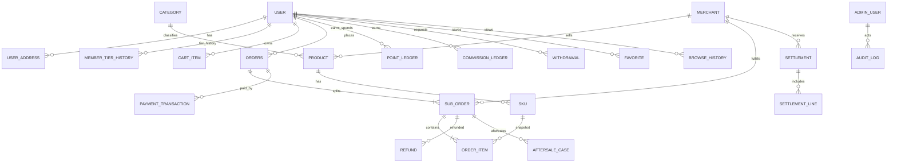

# 电商平台 V1.0 — Phase 1 需求拆解与设计基线

版本：0.1（基于用户提供的思维导图图片人工识读）  
状态：待业务确认；不授权进入 Phase 2  
原图：`codex-clipboard-efff90c2-52f2-4db0-bc4c-260140fbf939.jpg`（对话附件；工作区未收到原始高分辨率源文件）

> 说明：编号对应原图可辨认的功能节点。用「待确认」标识原图文字不清、语义不完整或仅为注释的地方。原图之外用户明确提出的平台自营+第三方入驻、多商家购物车/拆单、账务能力、合规与支付约束，单独标为“专项约束”，不计入原图功能数。原图未画出的商家门户和结算不伪称来自原图。

## 1. 原图识读总览

- 可辨认一级主干：2 个（前端、后台）。
- 原图后台模块：自选/复购商品管理、订单管理、会员、财务中心、服务中心、后台桌面、系统设置。
- 原图前端模块：首页、自选区、复购区、购物车、分销、我的。
- 清晰可拆解的功能需求：约 120 条（一级主干下按可操作功能拆为原子需求；同一个页面中的独立字段/动作分别计）。因附件被缩放且水印遮挡，精确计数须以源图复核；本清单提供编号与初步计数，非“无歧义最终数”。
- 识读状态：主干与大部分节点可辨；若干小字待确认。完整功能清单中的 TBC 标记不可作为已确认规则实施。

## 2. 完整功能清单（按原图层级）

### A. 前端

#### A01 首页
- REQ-FE-HOME-001 搜索栏。
- REQ-FE-HOME-002 Banner 图片。
- REQ-FE-HOME-003 消息通知。
- REQ-FE-HOME-004 自选区推荐商品；注释：用户商品积分或现金购买（具体规则见待确认）。
- REQ-FE-HOME-005 复购区推荐商品；注释：可用 30% 复购积分 + 70% 现金购买（原图数字，待合规/业务确认）。
- REQ-FE-HOME-006 底部导航：首页、自选区、复购区、我的。（2026-10-10 复核原图更正：购物车是独立分支，不在此导航文字中。）

#### A02 自选区
- REQ-FE-PICK-001 商品筛选：全部、销量、价格。
- REQ-FE-PICK-002 商品分类；原图列举：生活百货、农副产品、休闲零食、酒水饮料、美妆护肤、数码电子、养生保健、服饰鞋帽等（末尾分类文字待确认）。
- REQ-FE-PICK-003 商品列表展示图片。
- REQ-FE-PICK-004 商品列表展示商品名称。
- REQ-FE-PICK-005 商品列表展示销量。
- REQ-FE-PICK-006 商品列表展示价格。
- REQ-FE-PICK-007 列表加入购物车。
- REQ-FE-PICK-008 商品详情展示图片/支持视频。
- REQ-FE-PICK-009 商品详情展示商品名称。
- REQ-FE-PICK-010 商品详情展示商品价格。
- REQ-FE-PICK-011 商品详情展示销量。
- REQ-FE-PICK-012 商品详情分享。
- REQ-FE-PICK-013 商品详情展示商品描述。
- REQ-FE-PICK-014 商品详情回首页。
- REQ-FE-PICK-015 商品详情在线咨询。
- REQ-FE-PICK-016 商品详情收藏。
- REQ-FE-PICK-017 商品详情加入购物车。
- REQ-FE-PICK-018 商品详情立即购买。
- 注释（原图绿框）：用户购买商品时，可用产品积分进行等额抵扣（具体适用商品、上限、与现金/其他积分的叠加顺序待确认）。

#### A03 复购区
- REQ-FE-REBUY-001 复购商品同上展示（原图引用“同上展示”，映射商品列表/详情节点，不合并为删除）。
- REQ-FE-REBUY-002 复购积分与现金购买，原图标注 30% 积分 + 70% 现金；计算口径、资格与退款处理待确认。

#### A04 购物车
- REQ-FE-CART-001 购物车商品列表。
- REQ-FE-CART-002 展示商家名字（原图如此，当前商家模式由用户确认为平台自营+第三方入驻）。
- REQ-FE-CART-003 展示产品图片。
- REQ-FE-CART-004 展示产品标题。
- REQ-FE-CART-005 展示价格。
- REQ-FE-CART-006 展示数量。
- REQ-FE-CART-007 删除商品。
- REQ-FE-CART-008 全选。
- REQ-FE-CART-009 结算。
- 用户专项约束：购物车允许多商家商品；结算拆分商家子订单。该规则不是原图明确节点，按用户现行要求纳入。

#### A05 分销
- REQ-FE-DIST-001 合伙人级别：在线购买 3999（原图）。
- REQ-FE-DIST-002 联创级别：在线购买 10000（原图）。
- REQ-FE-DIST-003 合伙人：成为合伙人可直接分享拿 10%（直推用户购买合伙人或联创后，原图称联创后“获得10%现金奖励”，具体基数待确认）；并同时获得对应复购积分。
- REQ-FE-DIST-004 合伙人“纯毛钱账”1 次（原图用词不清，TBC）。
- REQ-FE-DIST-005 自动充入 3999 产品积分：产品积分用于购买产品。
- REQ-FE-DIST-006 自动充入 3999 复购积分：复购积分用于复购区，原图注记 30% 复购积分 + 70% 现金购买产品。
- REQ-FE-DIST-007 合伙人 1 代每日分红（原图：无分享情况下 1200 封顶；分享 1 个封顶上限 +1200，分享 3 个上限 +12000；“封顶”与增量关系待确认）。
- REQ-FE-DIST-008 联创：成为联创可直接分享拿 10%（直推购买联创后获得 10% 现金奖励），同时获得对应复购积分；基数/返奖条件待确认。
- REQ-FE-DIST-009 联创“纯毛钱账”1 次（原图用词不清，TBC）。
- REQ-FE-DIST-010 自动充入 10000 产品积分：用于购买产品。
- REQ-FE-DIST-011 自动充入 10000 复购积分：用于复购区，原图标注 30% 积分 + 70% 现金购买产品。
- REQ-FE-DIST-012 联创 3 代每日分红（原图同样写 1200 封顶、分享 1 个 +1200、分享 3 个 +12000；逻辑待确认）。
- REQ-FE-DIST-013 分享每单另享 200 元（适用商品/订单、计算和发放时机待确认）。
- REQ-FE-DIST-014 我的邀请码（邀请二维码）。
- REQ-FE-DIST-015 我的推荐：查看到注册用户。
- REQ-FE-DIST-016 我的收益：可提现。
- REQ-FE-DIST-017 我的收益明细。
- 注释（原图绿框）：推广时扣除 0.6% 手续费（费率基数、收取方、适用收益类型待确认）。
- 注释（原图绿框）：用户购买合伙人/联创后，部分金额进入某分红（原文被遮挡/无法可靠识读，TBC）。

#### A06 我的
- REQ-FE-ME-001 用户信息：头像。
- REQ-FE-ME-002 用户信息：昵称。
- REQ-FE-ME-003 用户信息：ID。
- REQ-FE-ME-004 用户角色：普通会员、合伙人、联创。
- REQ-FE-ME-005 钱包展示可提现余额。
- REQ-FE-ME-006 立即提现。
- REQ-FE-ME-007 余额明细：推广收益明细。
- REQ-FE-ME-008 产品积分：可用积分。
- REQ-FE-ME-009 产品积分明细。
- REQ-FE-ME-010 复购积分：可用积分。
- REQ-FE-ME-011 复购积分明细。
- REQ-FE-ME-012 我的订单状态：待付款、付款、待发货、待收货、已完成、退款/售后（原图状态词保持；状态机待确认）。
- REQ-FE-ME-013 在线咨询。
- REQ-FE-ME-014 我的收藏。
- REQ-FE-ME-015 我的足迹。
- REQ-FE-ME-016 收货地址。

### B. 后台

#### B01 自选/复购商品管理
- REQ-ADM-GOODS-001 商品分类添加。
- REQ-ADM-GOODS-002 商品分类删除。
- REQ-ADM-GOODS-003 商品分类编辑管理。
- REQ-ADM-GOODS-004 分类管理。
- REQ-ADM-GOODS-005 展示所有商品。
- REQ-ADM-GOODS-006 产品详细信息查看。
- REQ-ADM-GOODS-007 商品添加。
- REQ-ADM-GOODS-008 商品修改。
- REQ-ADM-GOODS-009 商品编辑管理。
- REQ-ADM-GOODS-010 商品上架/下架。
- 注释（原图绿框）：自选商品、复购商品是否关联/会员体系，原文不清，TBC。

#### B02 订单管理
- REQ-ADM-ORDER-001 订单状态筛选：待发货、待收货、已完成、退款/售后（具体原图文字依图）。
- REQ-ADM-ORDER-002 订单销量汇总。
- REQ-ADM-ORDER-003 订单详情：商品信息。
- REQ-ADM-ORDER-004 订单详情：买家信息。
- 用户专项：平台/商家独立订单核算、按商家拆单、独立发货和售后、支付退款流水、对账及异常资金处理。

#### B03 会员
- REQ-ADM-MEMBER-001 会员列表。
- REQ-ADM-MEMBER-002 会员管理。
- REQ-ADM-MEMBER-003 会员身份：普通会员。
- REQ-ADM-MEMBER-004 会员身份：合伙人。
- REQ-ADM-MEMBER-005 会员身份：联创。
- REQ-ADM-MEMBER-006 查看会员详细信息。
- REQ-ADM-MEMBER-007 查看会员收货地址。
- REQ-ADM-MEMBER-008 查看会员消费统计。
- REQ-ADM-MEMBER-009 查看自选商品订单。
- REQ-ADM-MEMBER-010 查看复购商品订单。
- REQ-ADM-MEMBER-011 允许/禁止会员登录。
- REQ-ADM-MEMBER-012 会员列表字段：会员ID、会员名称、真实姓名、手机号、邮箱、性别、关联微信、登录次数、注册时间。
- REQ-ADM-MEMBER-013 注册通知/新增会员数统计。
- REQ-ADM-MEMBER-014 会员消费统计：新增/活跃会员、今日消费会员/金额、会员总消费、金额统计图。

#### B04 财务中心
- REQ-ADM-FIN-001 资金分析：按日、月同比，数据展现形式待确认。
- REQ-ADM-FIN-002 查看平台总交易资金。
- REQ-ADM-FIN-003 产品积分明细。
- REQ-ADM-FIN-004 复购积分明细。
- REQ-ADM-FIN-005 佣金余额。
- REQ-ADM-FIN-006 已提现佣金。
- REQ-ADM-FIN-007 佣金提现审核。
- REQ-ADM-FIN-008 佣金提现记录。
- 用户专项：商家订单独立核算、平台服务费、支付及退款流水、商家结算记录、佣金账本、结算对账、资金异常处理；不得用数据库余额伪造真实资金到账。

#### B05 服务中心
- REQ-ADM-SERVICE-001 账号与安全。
- REQ-ADM-SERVICE-002 隐私政策。

#### B06 后台桌面
- REQ-ADM-DASH-001 清除缓存。
- REQ-ADM-DASH-002 数据概览：总用户、活跃用户、新增用户等。
- REQ-ADM-DASH-003 图表：每日总用户与活跃用户数、新增用户数、用户区域、性别。
- REQ-ADM-DASH-004 系统首页。
- REQ-ADM-DASH-005 用户：修改密码。
- REQ-ADM-DASH-006 用户：系统锁屏。
- REQ-ADM-DASH-007 用户：退出系统。

#### B07 系统设置
- REQ-ADM-SET-001 系统参数。
- REQ-ADM-SET-002 公司信息：公司名称、微信二维码/地址/电话/手机/邮箱/QQ（字段原文可辨，是否全部启用待确认）。
- REQ-ADM-SET-003 水印设置。
- REQ-ADM-SET-004 上传设置：图片大小、图片后缀/格式、图片优化、图片宽度、附件大小等（细项待确认）。
- REQ-ADM-SET-005 后台目录。
- REQ-ADM-SET-006 IP访问设置：限制访问IP。
- REQ-ADM-SET-007 短信设置：账号/密码/短信接口/发送线路。
- REQ-ADM-SET-008 小程序名称、APPID、SECRET。
- REQ-ADM-SET-009 管理首页：省/市/县（区）/街道地址库管理。
- REQ-ADM-SET-010 管理首页：发送记录。
- REQ-ADM-SET-011 管理首页：访问统计。
- REQ-ADM-SET-012 管理首页：日志管理。
- REQ-ADM-SET-013 图片管理：列表模式/图文模式/文件夹模式/图片统计。
- REQ-ADM-SET-014 部门创建/权限设置。
- REQ-ADM-SET-015 管理用户。
- REQ-ADM-SET-016 管理员设置。
- REQ-ADM-SET-017 登录日志。
- REQ-ADM-SET-018 数据库管理：数据表优化/修复/结构/查看操作。
- REQ-ADM-SET-019 数据库管理：数据备份。
- REQ-ADM-SET-020 查看备份。
- REQ-ADM-SET-021 备份下载/删除/还原。
- 注释（原图绿框）：图片管理可按多个条件删除（规则与范围待确认）。

## 3. 原图节点到系统模块映射

| 原图节点 | 需求编号范围 | 系统模块 | 计划阶段 |
|---|---|---|---|
| 前端-首页 | FE-HOME | 移动商城首页/CMS | P4、P8 |
| 前端-自选区 | FE-PICK | 商品目录/搜索/详情/收藏 | P3、P4 |
| 前端-复购区 | FE-REBUY | 复购商品目录与积分支付规则 | P4、P7 |
| 前端-购物车 | FE-CART | 多商家购物车/结算拆单 | P4、P5 |
| 前端-分销 | FE-DIST | 会员等级、推广、佣金、提现、合规开关 | P7（合规确认前禁用） |
| 前端-我的 | FE-ME | 账户、积分账本、订单、客服、地址 | P2、P5、P7 |
| 后台-商品管理 | ADM-GOODS | 商品、分类、上下架 | P3 |
| 后台-订单管理 | ADM-ORDER | 平台订单运营/售后 | P5 |
| 后台-会员 | ADM-MEMBER | 会员查询、状态、报表 | P2、P7、P8 |
| 后台-财务中心 | ADM-FIN | 支付、退款、积分/佣金账本、提现 | P5、P6、P7 |
| 后台-服务中心 | ADM-SERVICE | 安全策略/隐私配置 | P2、P8 |
| 后台-后台桌面 | ADM-DASH | 后台概览与用户账户操作 | P2、P8 |
| 后台-系统设置 | ADM-SET | 系统参数、文件/短信、地址库、权限、日志、备份 | P2、P8、P9 |
| 用户明确专项约束 | SUP-*（另册/新增需求） | 商家入驻/商家工作台、平台自营、拆单、服务费、结算对账、资金异常、合规、支付服务商 | P2、P3、P5、P6、P7 |

## 4. 系统架构建议

- 移动端商城：Vue 3 + Vant；首页、目录、商品详情、购物车、订单、个人中心。
- 平台运营后台：Vue 3 + Element Plus；权限、商品、订单、会员、财务、运营和系统设置。
- 商家工作台：Vue 3 + Element Plus，独立租户边界、数据范围权限；作为“第三方商家入驻”闭环所需能力，原图未画出，须确认商家端范围。
- API：FastAPI，按身份/领域拆分模块；REST/JSON，OpenAPI；OAuth/JWT 或安全会话，RBAC/商家数据范围隔离。
- 数据：MySQL 8 为交易事实与账本；Redis 用于缓存、限流、短期会话/幂等辅助，不作为资金事实来源。
- 文件：腾讯云 COS，数据库仅存对象键、元数据；后端签发受限上传凭证。
- 部署：Nginx TLS/反向代理 + systemd 管理 API/worker；定时备份、日志、监控与恢复演练。
- 支付/结算：持牌且具备分账能力的支付服务商；支付、退款、分账结果经签名回调并与渠道对账。禁止将内部余额当作实际到账。
- 异步任务：订单超时、支付回调补偿、通知、对账、报表等；任务必须幂等并可审计。

## 5. 数据库 ER 图（逻辑初稿）

### 主要数据表（初稿）

| 表 | 关键字段/约束 | 用途 |
|---|---|---|
| users | id, phone, email, password_hash, nickname, avatar, status, created_at | 会员账户；手机号/邮箱唯一性规则待定 |
| user_addresses | id, user_id, receiver, phone, region_codes, address, is_default | 收货地址 |
| member_tiers | id, code, name, rules_json, enabled | 等级定义；不得将图中规则硬编码，确认后版本化 |
| member_tier_history | user_id, tier_id, effective_at, reason, source_order_id | 等级变更审计 |
| merchants | id, name, type(self/third_party), status, onboarding_status | 自营/商家主体；入驻字段需确认 |
| merchant_users | merchant_id, user_id, role, status | 商家用户关联和权限 |
| categories | id, parent_id, name, sort, status | 多级商品分类 |
| products | id, merchant_id, category_id, title, description, product_type(pick/rebuy), status, audit_status | 商品主档及商家归属 |
| product_media | id, product_id, media_type, cos_key, sort | 图片/视频 |
| skus | id, product_id, sku_code, attrs_json, price, stock, status | SKU、价格库存 |
| inventory_movements | id, sku_id, delta, reason, ref_type, ref_id, created_at | 库存流水 |
| carts / cart_items | user_id; sku_id, merchant_id, quantity, selected | 跨商家购物车 |
| orders | id, order_no, user_id, total_amount, discount_amount, payable_amount, status, address_snapshot | 用户主单 |
| sub_orders | id, order_id, merchant_id, sub_order_no, goods_amount, service_fee, status, fulfillment_status | 按商家拆分的子单 |
| order_items | sub_order_id, product_snapshot, sku_snapshot, qty, unit_price, points_used | 下单快照 |
| payment_transactions | id, order_id, provider, provider_txn_id, amount, status, idempotency_key | 渠道支付流水 |
| refunds | id, sub_order_id, provider_refund_id, amount, reason, status | 退款申请/渠道流水 |
| aftersale_cases | id, sub_order_id, order_item_id, type, reason, status, resolution | 售后流程 |
| point_accounts | user_id, point_type(product/rebuy), available, frozen | 积分余额投影（以账本为准） |
| point_ledger | id, user_id, point_type, delta, balance_after, event_type, ref_type, ref_id | 积分不可变流水 |
| commission_rules | id, version, rule_json, status, compliance_status | 佣金规则版本；上线需合规确认 |
| commission_ledger | id, user_id, source_user_id, order_id, rule_version, amount, status, reversal_of | 佣金应计/冲正流水 |
| withdrawals | id, user_id, amount, fee, status, provider_ref, requested_at | 提现申请及支付结果 |
| merchant_settlements | id, merchant_id, period, gross, refunds, service_fee, net, status, provider_batch_id | 商家结算批次 |
| settlement_lines | settlement_id, sub_order_id, amount, adjustment, status | 子单结算明细 |
| favorites / browse_history | user_id, product_id, created_at | 收藏和足迹 |
| banners / notices | id, media_key/content, link, start_at, end_at, status | 首页素材与消息 |
| admin_users / roles / permissions / role_permissions | 主键、角色权限关联 | 后台 RBAC |
| audit_logs | actor_id, action, target_type, target_id, diff_json, created_at | 管理操作审计 |
| system_settings | key, value_encrypted, updated_by, updated_at | 参数；SECRET 等加密存储 |
| payment_reconciliations | provider, batch_date, external_ref, internal_ref, amount, diff, status | 支付/退款/分账对账与差异处置 |

金额统一 DECIMAL(18,2)，积分使用整数最小单位；所有账本追加写入，修改以冲正记录表达。订单、支付、退款、库存变更要有幂等键和审计信息。字段/索引/删除策略、币种、税务口径需 Phase 1 评审后定稿。

## 6. 前端页面与菜单规划

### 移动商城（Vant）

- 首页：搜索、Banner、通知、推荐商品、底部导航。
- 自选区：分类、排序筛选、商品列表、商品详情、分享、咨询、收藏、加购、立即购买。
- 复购区：商品列表/详情、积分+现金购买说明与资格提示。
- 购物车：跨商家分组、商品选择/数量/删除、结算确认。
- 订单：主订单/商家子订单、详情、支付、物流、取消、确认收货、退款/售后。
- 分销中心：等级/资格说明、邀请码、推荐列表、收益/明细、提现（规则未确认则隐藏/禁用）。
- 我的：资料、钱包、产品积分、复购积分、订单、咨询、收藏、足迹、地址。

### 平台后台（Element Plus）

- 工作台/数据概览。
- 商品管理：分类、自营商品、商家商品审核、上下架、媒体。
- 订单管理：订单/子订单、发货、退款售后、状态筛选、销量汇总。
- 商家管理（专项）：入驻审核、资质、账户、商品与订单数据范围。
- 会员管理：列表、详情、地址、消费、订单、登录状态、等级历史。
- 财务中心：支付/退款流水、积分账本、佣金账本、提现审核、商家结算、服务费、对账、异常处理。
- 运营管理：Banner、通知、咨询、报表。
- 系统：服务/隐私、参数、上传、短信、小程序凭据、地址库、图片资源、管理员/部门/权限、日志、数据库备份。

### 商家工作台（范围待确认）

- 商品管理、订单/子订单、发货、售后、结算单、对账、店铺资料、员工权限。以上是多商家业务闭环建议，不属于原图已识别节点。

## 7. API 清单（按资源规划，Phase 1 草案）

统一前缀 `/api/v1`；需定义错误码、分页、鉴权、幂等、审计和版本策略。

| 域 | 方法与路径（规划） | 说明 |
|---|---|---|
| 认证 | POST `/auth/register`, `/auth/login`, `/auth/logout`; GET `/auth/me` | 注册登录及会话 |
| 首页 | GET `/storefront/home`; GET `/banners`; GET `/notices` | 首页内容 |
| 商品 | GET `/products`; GET `/products/{id}`; GET `/categories`; GET `/products/{id}/related` | 列表、筛选、详情 |
| 购物车 | GET/POST/PATCH/DELETE `/cart/items[/{id}]`; POST `/checkout/preview` | 多商家预结算 |
| 订单 | POST `/orders`; GET `/orders`; GET `/orders/{id}`; POST `/orders/{id}/cancel`; POST `/orders/{id}/confirm-receipt` | 主单和子单 |
| 支付 | POST `/payments`; POST `/webhooks/payments/{provider}` | 发起支付与签名回调 |
| 退款/售后 | POST `/sub-orders/{id}/aftersales`; GET `/aftersales`; POST `/admin/aftersales/{id}/review`; POST `/refunds` | 售后及退款 |
| 会员 | GET `/members/me`; GET `/admin/members`; GET `/admin/members/{id}`; PATCH `/admin/members/{id}/status` | 会员档案与管理 |
| 地址/收藏/足迹 | CRUD `/addresses`; POST/DELETE `/favorites`; GET `/browse-history` | 我的功能 |
| 积分 | GET `/points/{type}/balance`; GET `/points/{type}/ledger` | 两类积分 |
| 分销 | GET `/distribution/profile`; GET `/invitations`; GET `/referrals`; GET `/commissions`; POST `/withdrawals` | 合规开关关闭时拒绝业务操作 |
| 商家 | POST `/merchant-applications`; GET `/merchant/orders`; POST `/merchant/sub-orders/{id}/ship`; GET `/merchant/settlements` | 专项新增，商家身份隔离 |
| 后台商品 | CRUD `/admin/products`, `/admin/categories`; POST `/admin/products/{id}/publish` | 商品管理 |
| 后台订单 | GET `/admin/orders`; GET `/admin/sub-orders`; GET `/admin/orders/summary` | 订单和统计 |
| 财务 | GET `/admin/payments`; GET `/admin/refunds`; GET `/admin/commission-ledger`; GET/POST `/admin/withdrawals`; GET `/admin/settlements`; POST `/admin/reconciliations` | 财务操作需强审计 |
| 报表/系统 | GET `/admin/reports/*`; CRUD `/admin/settings`; `/admin/roles`; `/admin/audit-logs`; `/admin/backups` | 权限配置、设置、日志/备份 |
| 上传/客服 | POST `/uploads/presign`; GET/POST `/consultations` | COS 临时凭证、咨询 |

## 8. 验收标准框架

每个 REQ 编号进入追踪矩阵，需补齐四列：页面/组件、API、表与字段、可观察验收条件。全局基线：权限隔离、输入校验、金额/积分精度、幂等、审计、失败补偿、移动端兼容。

代表性验收：
- 多商家购物车结算生成一个用户主单和按商家隔离的子单；每个子单只由所属商家人员读取/发货/处理售后。
- 任何支付/退款状态必须有支付服务商流水或明确失败状态；回调重复投递不得重复记账。
- 积分与佣金余额必须可由不可变流水重算；退款按已确认规则生成冲正，不删除历史。
- 未经合规确认的会员购买资格、推广计酬、多层奖励功能不可启用；相关后台设置需默认关闭并有审计。
- 原图所有已确认节点逐一在验收矩阵中有页面/API/DB/验收证据；TBC 条目不视为通过。

## 9. 待确认业务规则 / 识读问题

1. 提供未压缩思维导图源文件（XMind/draw.io/PDF 或原始大图），核实功能节点总数和水印遮挡内容。
2. “纯毛钱账”真实文字及含义；分红节点的“1200封顶 / 分享1个+1200 / 分享3个+12000”是日封顶、增量还是累计上限。
3. 合伙人 3999、联创 10000 的购买资格、是否含货品、退款后等级/积分/佣金如何处理。
4. 10%现金奖励基数、直推定义、联创/合伙人相互购买关系；200元/单的适用订单、承担主体和发放时点。
5. 30%复购积分+70%现金是固定比例还是最高抵扣比例；适用品类、积分到期/转让/退款处理。产品积分等额抵扣的上限和互斥规则。
6. 推广 0.6% 手续费的基数、收取方、舍入、退款冲回方式。
7. 原图绿注“部分金额进入分红”的完整文字和资金来源。
8. 会员等级升级/降级条件、有效期与人工调整权限；图中只清晰出现普通会员/合伙人/联创及购买金额线索。
9. 订单/退款/售后状态机、自动收货、拆单后运费与优惠分摊、佣金/积分冲正规则。
10. 商家入驻资料/审核/合同/费率/服务费/结算周期/账期/保证金及平台代发货或商家发货边界（用户已要求商家入驻与结算，但原图没有明确流程）。
11. 真实支付服务商、分账能力、退款与分账冲正接口、对账文件格式由项目方提供/确认。
12. 原图字段如邮箱、微信关联、短信线路、APPID/SECRET 的实际启用范围；敏感配置保管方式。
13. 原图消费统计“同比”、活跃定义、用户区域/性别的统计口径和图表维度。

## 10. Phase 2 可执行开发任务（仅计划，不启动）

前置门槛：业务方确认本文件需求基线；确认平台自营+第三方商家最低闭环、商家身份/审核范围；确认技术环境与支付接入方式。分销/等级规则可在合规确认前保持关闭。

1. 初始化仓库结构：`apps/storefront`（Vue3/Vant）、`apps/admin`（Vue3/Element Plus）、`apps/api`（FastAPI）、`infra`（Nginx/systemd/备份配置）；建立环境配置样例与本地启动文档。
2. 建立 FastAPI 配置、日志、统一响应/异常、OpenAPI、健康检查和版本化路由。
3. 建立 MySQL 8 schema、Alembic 迁移、UTC 时间/金额类型约定、基础种子数据；实现迁移回滚演练说明。
4. 建立 Redis 连接与缓存/限流/幂等辅助封装；明确 Redis 故障时交易写入策略。
5. 建立用户注册/登录/登出、密码哈希、账号状态、会话续期/撤销；实现后台管理员登录与强制改密策略。
6. 实现 RBAC（角色/权限/菜单/API）以及商家租户数据范围隔离；建立平台管理员、运营、财务、商家管理员/员工最小角色模板。
7. 建立审计日志与敏感操作审计（角色变更、账号禁用、配置修改、账务人工调整）。
8. 建立 COS 上传签名服务的接口层和文件元数据表；验证文件类型/大小策略来自系统配置。
9. 建立前端后台骨架：登录、菜单、路由守卫、权限按钮、用户/角色管理；移动端骨架先仅接认证与基础个人资料。
10. 建立 systemd/Nginx 示例、密钥外置、TLS/反代头、日志轮转、数据库备份与恢复脚本说明；禁止提交真实密钥。
11. 按 Phase 2 独立验收清单验证：未授权 API 拒绝、角色权限生效、商家 A 不能访问商家 B 数据、禁用用户失效、审计留痕、迁移/恢复可复现。
12. Phase 2 验收通过并经用户另行确认后，才进入 Phase 3。

---

本文件是 Phase 1 初稿。它不构成业务规则确认，也没有启动 Phase 2。原图规则与平台专项要求冲突时，先提交确认，不以实现便利自行裁定。
